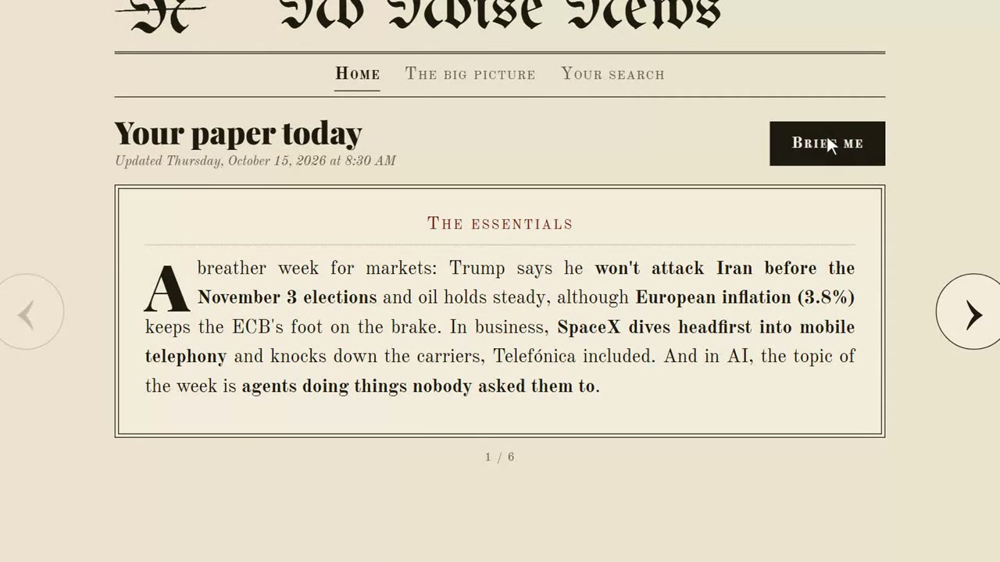

  

<h1 align="center">No Noise News</h1>

  <b>Tu periódico de hoy, escrito para ti.</b> 
  Una compilación diaria de noticias que funciona en tu ordenador con Claude. Le dices lo que te importa; busca, elige las noticias que van contigo y te las escribe para leerlas en diez minutos.

  <a href="README.md">English</a> · <b>Español</b>

  

## Demo

Un minuto y medio, del cuestionario a tu primer periódico (pulsa para verlo; el vídeo está en inglés):

  

## Qué hace

- **Solo tus noticias.** Un cuestionario corto: cuántas noticias, qué temas y cuánto pesa cada uno (*Siempre*, *Más*, *Normal*, *Menos*, *Nunca*), y lo que quieras contarle con tus palabras.
- **Escritas para ti, no copiadas.** Claude lee la actualidad de las últimas 24-48 horas y escribe cada noticia él mismo: qué pasa, el contexto mínimo y por qué te importa. Lo clave va en negrita, para leer en diagonal.
- **Siempre con fuentes.** Al menos dos por noticia, marcadas como gratis o de pago. No se inventa nada: ni cifras, ni citas, ni enlaces que no haya leído.
- **Pregunta lo que quieras.** Debajo de cada noticia, «Quiero saber más» profundiza y «Pregúntame» te explica lo que no entiendas, como lo haría un amigo listo.
- **Aprende de ti.** «No me interesa», con un porqué opcional, afina la siguiente compilación.
- **En general.** Una pestaña aparte con cómo está el mundo: los grandes temas mundiales, los países que sigues y los indicadores clave (petróleo, tipos, inflación, bolsas), cada uno con una frase que dice si está bien o mal.
- **En tu idioma.** Español, inglés, francés y alemán. Si lo cambias, tus noticias se traducen.

## Cómo funciona

Hablas con Claude en la app de Claude; No Noise News es la página de al lado, donde lees y pulsas botones. Cada botón le dice a Claude qué hacer: «Infórmame» trae las de hoy, «Quiero saber más» amplía una, «Pregúntame» responde una duda. Todo se queda en tu ordenador.

## Para empezar

No hace falta saber nada de ordenadores. Son tres cosas y de lo demás se encarga Claude.

1. **Instala Claude.** Entra en [claude.ai/download](https://claude.ai/download), descarga la versión para Windows, ábrela e inicia sesión. Necesitas una suscripción de pago (Pro o Max).
2. **Descarga No Noise News.** En esta misma página, arriba, pulsa el botón verde **Code** y luego **Download ZIP**. Cuando termine, ve a tu carpeta de Descargas, haz clic derecho en el archivo y elige **Extraer todo**. Deja la carpeta que sale donde quieras, por ejemplo en Documentos.
3. **Ábrela con Claude.** Haz doble clic en **Abrir con Claude** dentro de la carpeta: se abre la app de Claude en ella con un saludo ya escrito, solo tienes que pulsar Intro. Si no funciona, abre la app de Claude, entra en la pestaña **Code** (arriba), elige la carpeta y escribe **hola**.

A partir de ahí, Claude prepara tu ordenador él solo (instala lo que haga falta, aunque no sepas qué es). Cuando te pida permiso para hacer algo, pulsa **Permitir**. A la derecha se abre la página con un cuestionario corto; guárdalo y pulsa **Infórmame**.

Para leer tus noticias sin abrir Claude, haz doble clic en **Abrir** dentro de la carpeta. Se abre en tu navegador; cierra la ventanita negra para apagarlo. Los botones solo funcionan con Claude abierto.

## La página

| Pestaña | Qué hay |
|---|---|
| **Inicio** | Lo esencial del día y tus noticias, una por tarjeta, con sus fuentes y los botones «Quiero saber más», «No me interesa» y «Pregúntame». |
| **En general** | Cómo está el mundo: indicadores explicados en cristiano y los grandes temas por ámbito (mundial y los países que sigues). |
| **Tu búsqueda** | Tu idioma, cuántas noticias, tus temas y su peso, y si quieres que busque solo al abrir Claude. |

  
  

También tiene modo noche.

  

## Actualizaciones

Una vez por semana, al abrirlo, Claude mira si hay versión nueva en esta página y se actualiza solo. Tus datos (perfil, noticias) no se tocan nunca. También puedes pedírselo: «actualízate».

## Tus datos

Todo se queda en tu ordenador, en la carpeta `datos/`, que nunca va a GitHub. La página solo funciona en tu propio ordenador.

## Estructura del proyecto

| Archivo | Qué es |
|---|---|
| `CLAUDE.md` | Las instrucciones de Claude: cómo te habla y cómo elige y escribe las noticias. |
| `panel.py` | El pequeño servidor local detrás de la página; apunta cada botón para Claude. Solo necesita Python. |
| `web/` | La página. |
| `.claude/` | Ajustes, la skill de actualización semanal y la vista previa de la página para la app de Claude. |
| `Abrir con Claude.bat`, `Abrir.bat` | Accesos directos: abrir con Claude, o solo la página. |

## Licencia

MIT. Ver [`LICENSE`](LICENSE).
